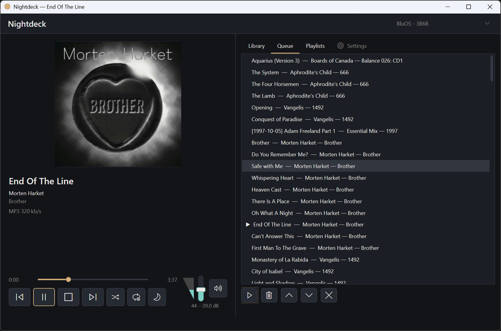

# Nightdeck for Windows

Nightdeck is a small native Windows player for BluOS. Version 1.1.0. It speaks the same HTTP API as [bluplay](https://github.com/fredrikspang-sys/bluplay) 0.3.1 on port 11000: long-poll `/Status`, library browse, queue, playlists, presets, grouping, and the sleep timer.

The goal is a small footprint and simplicity. The exe is about 397 KB, and the release zip is about 167 KB. It needs the .NET 9 Desktop Runtime. There is no telemetry and no account. It talks to the player on the local network. Streaming services are not supported. Nightdeck browses and plays the player's local library.

Nightdeck is not affiliated with BluOS, Lenbrook, or Bluesound.

## Screenshots



## Download

Download `Nightdeck-1.1.0-win-x64.zip` from [Releases](https://github.com/fredrikspang-sys/nightdeck-win/releases), unzip it and run `Nightdeck.exe`. It needs the [.NET 9 Desktop Runtime (x64)](https://dotnet.microsoft.com/download/dotnet/9.0).

The exe is not signed, so Windows SmartScreen may warn the first time. Choose More info, then Run anyway.

There is also a [macOS version](https://github.com/fredrikspang-sys/nightdeck).

## Requirements

Build with the .NET 9 SDK. Run with the .NET 9 Desktop Runtime (x64). No extra packages.

## Build

```powershell
.\build.ps1
```

That publishes a framework-dependent single-file build to `out\Nightdeck.exe`.

## Run

```powershell
.\out\Nightdeck.exe
```

There is no default player. Set a host in Settings, or open the player list and choose Discover (mDNS `_musc._tcp`, then `_musp._tcp`, then `_musz._tcp`). The mDNS query goes out on every LAN adapter, so a VPN adapter such as Tailscale or ZeroTier does not swallow it. When mDNS finds nothing, Nightdeck checks port 11000 on the local /24 of each adapter that has a gateway and confirms a player with one read-only `GET /SyncStatus`. The port is 11000 unless you change it. Settings are stored in `%AppData%\Nightdeck\config` (`Host`, `Port`, and a few options).

Settings → Music library lists the network shares (SMB folders on a NAS or PC) that the player indexes. You can add a share (`\\server\share`, user name, password), remove shares, and start a reindex there; Nightdeck asks before it removes a share or reindexes. BluOS sends share passwords unencrypted on the local network. Nightdeck does not store them.

The player button in the header lists players and shows which room is the group master. Add a slave from that list. Use the group line on Now playing to leave a group.

The volume fader sits under the cover. It sends a level when you release it. Stop ends playback. Sleep starts the player timer; if the player keeps playing when that timer hits zero, Nightdeck fades the volume and then pauses (or stops, if that option is on).

Closing the window hides it when the tray icon is on. Right-click the tray icon and choose Exit to quit. Left-click the icon to show the window again.

Space controls play and pause while the window is focused and a text box or button does not have the key. Key repeat is ignored. Keyboard media keys go to the Windows media overlay, which is a small COM caller. If the overlay cannot be created, those keys control transport while the window is focused.
